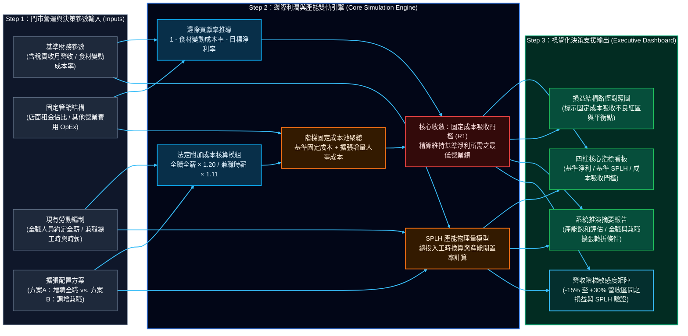

# 獨立餐飲門市邊際利潤與勞動產能推演系統<br><small>—— 基於階梯式固定成本吸收模型與 SPLH 人時產能邊界之量化決策引擎</small>

> 承接《台灣餐飲業 2015–2024：總體產值與個體營運分析》之個體財務可行性衍生研究

**License:** MIT | **Core Engine:** Python (Pandas / Plotly) | **Deployment:** Streamlit Cloud

---

### 專案背景與研究脈絡 (Research Context)
在前期實證專案 [**《台灣餐飲業 2015–2024：總體產值與個體營運分析》**](https://github.com/GuanYingLin/Taiwan-Catering-Industry-2015-2024) 中，透過全國稅籍底冊與部會調查數據證實：佔全台餐飲母體 73.83% 之微型小規模營業人，在實質消費量停滯（2024 年實質營業額 -1.37%）與剛性成本攀升（食材年均佔比 46.01%、法定基本時薪十年調升 +59.1%）之雙重擠壓下，月均歇業規模較前期擴大 +26.6%。

研究結論指出，微型餐飲之存續高度取決於初創與擴張期對**「人事配置極簡化」**與**「固定成本邊界」**之控制。為將此一定性結論轉化為可量化操作之決策工具，本專案建構個體門市層級之**邊際利潤與勞動產能推演系統**，量化檢驗門市於增聘人力時面臨之「固定成本吸收不良區間（Under-absorption Interval）」與產能閒置風險。

→ [**點擊進入：線上互動式邊際利潤與產能推演系統 (Streamlit App)**](https://catering-marginal-profit-sim.streamlit.app/)

---

## 1. 核心管理會計與運籌學框架 (Theoretical Framework)

本系統摒棄傳統靜態損益表（Static P&L）之線性假設，導入以下三項個體營運模型：

- **【階梯式固定成本吸收模型 (Step-Fixed Cost Absorption)】**
  傳統簡易試算常將人事支出視為隨營收平滑變動之比率。實務上，全職人員編制屬於剛性之「階梯式固定成本」。當門市增聘 1 名全職人員時，固定成本池立即產生離散跳增，使損益平衡點大幅右移。系統精確推導維持既有實質淨利所需之「成本吸收營收門檻 ($R_1$)」，標示出營收增長卻伴隨淨利倒縮之風險區間。
- **【勞動產能物理邊界與人時銷售額 (SPLH, Sales Per Labor Hour)】**
  單純依賴「人事成本率 (%)」易受終端售價調整與通膨因素干擾。本模型引入連鎖餐飲業衡量現場產能之核心物理指標 **SPLH（月營業額 ÷ 月投入總工時）**。透過設定常態產能健康帶（650 至 800 元/小時），量化診斷現有編制是否處於產能超載，並精算增聘人力後於未達規模前所產生之「實質工時閒置率」。
- **【法定人事附加成本參數化 (Statutory Labor Costing)】**
  針對微型業者於排班決策時常忽略之法定隱性成本，底層引擎依據台灣勞動法規（勞工保險、全民健康保險、6% 勞工退休金強制提繳、職災及就業保險雇主負擔比例）進行參數化內化：全職人員按約定全薪自動加權 **1.20 倍**，時薪制兼職人員自動加權 **1.11 倍**，確保損益推演符合實質現金流出。

---

## 2. 系統演算邏輯與資料流向架構 (System Architecture)



---

## 3. 核心數學推導公式 (Mathematical Formulation)

設門市基準月營業額為 $R_0$，食材變動成本率為 $c$，基準固定成本池（含店租、其他營業費用 OpEx 與現有人事總支出）為 $F_0$，則基準月淨利 $\Pi_0$ 為：

$$\Pi_0 = R_0 \times (1 - c) - F_0$$

當執行產能擴張方案，新增人事法定總成本為 $\Delta L$ 時，擴張後之新固定成本池為 $F_1 = F_0 + \Delta L$。若以「維持基準實質淨利金額（$\Pi_1 \ge \Pi_0$）」作為擴張吸收底線，則擴張後所需達到之最低營業額門檻 $R_1$ 為：

$$R_1 = \frac{F_0 + \Delta L + \Pi_0}{1 - c} = R_0 + \frac{\Delta L}{1 - c}$$

當擴張後之實際營業額 $R^*$ 落於區間 $R_0 < R^* < R_1$ 時，即落入「固定成本吸收不良區間（Under-absorption Interval）」，此時邊際毛利增量小於新增固定人事成本（$(R^* - R_0)(1 - c) < \Delta L$），產生「營業額成長、實質淨利倒縮」之現象。

---

## 4. 本地端環境建置與執行 (Quick Start)

```bash
# 1. 複製專案儲存庫
git clone [https://github.com/GuanYingLin/Catering-Marginal-Profit-Simulation-Engine.git](https://github.com/GuanYingLin/Catering-Marginal-Profit-Simulation-Engine.git)
cd Catering-Marginal-Profit-Simulation-Engine

# 2. 安裝相依套件
pip install -r requirements.txt

# 3. 啟動本地端互動式推演伺服器
streamlit run app.py
```